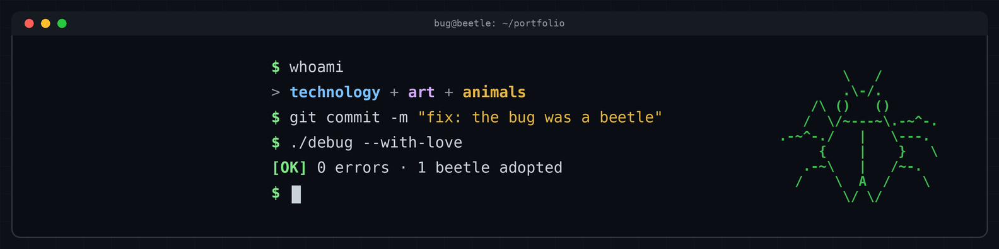

<h1>Hi everybody, it's Dano  	</h1>

## 🚀 About Me

I'm a cross platform app developer 👨‍🎓 who really enjoys coding.

I am passionate about programming and always eager to learn more about computer science. My innate curiosity led me to wonder how my home router worked, which marked the beginning of my journey into this world. While studying backend and networking to understand how that small device operated, I discovered the vast possibilities hidden within the world of binary code. But I didn’t stop there; I decided to take it a step further and learn how to write my own code, exploring the magic of technological creation

 - 🎓 **42 Madrid**: Currently studying at 42 Madrid, learning C/Python, system programming, software architecture and more.
 - 🛠️ **Focus**: Working on core C programming, Shell scripting, and building automated tools for my workflow.
 - ⚡ **Fun Fact**: Building my own automation tools to streamline my daily 42 project setup!

---

<table>
<tr>
<td colspan="2" align="center">

  
</td>
</tr>

<tr>
<td valign="top" align="center">
  
## :desktop_computer: Languages I use

| Language                                                                        | Primary use          |
| ------------------------------------------------------------------------------- | -------------------- |
|         | Cross platform apps  |
|   | Mobile apps          |
|           | Unity videogames     |
|     | Web development      |
|    | Databases, web apps  |

</td>
<td valign="top" align="center">

## :computer: Starting with...
| Language                                                                   | Primary use                            |
| -------------------------------------------------------------------------- | -------------------------------------- |
|       | Know low level code and memory use     |
|      | Learn about scripting and AI           |
|      | Backend and cloud/web projects         |
|  | Android apps                           |
|   | Better web development                 |

</td>
</tr>
</table>

## :toolbox: Main basic projects index

| [Genesis](https://github.com/LeoDanoGG/Genesis) | [LIBFT](https://github.com/LeoDanoGG/LIBFT) | [Get_Next_Line](https://github.com/LeoDanoGG/GNL) | [Printf](https://github.com/LeoDanoGG/PRINTF) | 
| :------------------------------------------------------: | :-------------------------------------------: | :-------------------------------------------------------: | :-------------------------------------------------------: |
|  |  |  |  |
| [Wild hunter](https://github.com/LeoDanoGG/Wild-hunter) | [Ice & Fire Wiki](https://github.com/LeoDanoGG/ice_and_fire) | [AstroLog](https://github.com/LeoDanoGG/AstroLog) | [Room manager](https://github.com/LeoDanoGG/RoomManager) |
|  |  |  |  |

