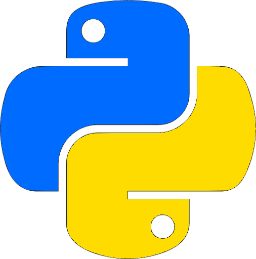
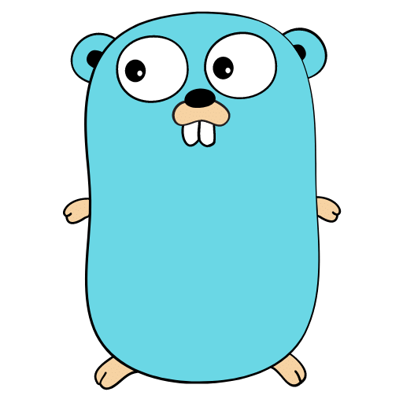

# :space_invader:	Hi everybody, it's Dano  
I'm a cross platform app developer 👨‍🎓 who really enjoys coding.

## 🚀 About Me

I am passionate about programming and always eager to learn more about computer science. My innate curiosity led me to wonder how my home router worked, which marked the beginning of my journey into this world. While studying backend and networking to understand how that small device operated, I discovered the vast possibilities hidden within the world of binary code. But I didn’t stop there; I decided to take it a step further and learn how to write my own code, exploring the magic of technological creation

- 🎓 **42 Madrid**: Currently studying at 42 Madrid, learning C/C++, system programming, software architecture and more.
- 🛠️ **Focus**: Working on core C programming, Shell scripting, and building automated tools for my workflow.
- ⚡ **Fun Fact**: Building my own automation tools to streamline my daily 42 project setup!

## :dart: Objectives
I would like to make good projects alone or in group.
- Work in effective projects.
  - Develop optimized apps.
  - Improve existing apps.
- Explore new technologies.
- Keep learning everyday.
- Work with other programmers.

##  Languages I use

  <table>
    <tr>
      <td>
        <table><!-- Lenguajes I know -->
          <tr><th>Language</th><th>Primary use</th></tr>
          <tr><td>Dart</td></td><td>Cross platform apps</td></tr>
          <tr><td>Java, Swift</td><td>Mobile apps</td></tr>
          <tr><td>C#</td><td>Unity videogames</td></tr>
          <tr><td>HTML, CSS, PHP</td><td>Web development</td></tr>
          <tr><td>SQL, PHP</td><td>Databases, web apps</td></tr>
        </table>     
      </td>
      <!--<td>
        
 Most used chart 
          <a href="https://github.com/LeoDanoGG">z
            
          </a>
        

      </td>-->
    </tr>
  </table>

### Starting with:
- C  to know deep code concepts and memory use.
- Python  for learn about AI.
- Go (golang)  for backend and cloud/web proyects.

## :toolbox: Main basic projects (big projects coming soon...) 

  <table>
    <tr>
      <td>
./42init
</td><td>&nbsp;<!-- Split -->&nbsp;</td>
      <td>
Wild hunter
</td><td>&nbsp;<!-- Split -->&nbsp;</td>
      <td>
Wiki with an API
</td><td>&nbsp;<!-- Split -->&nbsp;</td>
      <td>
AstroLog
</td><td>&nbsp;<!-- Split -->&nbsp;</td>
      <td>
Room manager
</td>
      <!--<td>

</td>-->
    </tr>
    <tr>
      <td></td><td>&nbsp;<!-- Split -->&nbsp;</td>
      <td></td><td>&nbsp;<!-- Split -->&nbsp;</td>
      <td></td><td>&nbsp;<!-- Split -->&nbsp;</td>
       <td></td><td>&nbsp;<!-- Split -->&nbsp;</td>
    <td></td>
      <!--<td></td>-->
    </tr>
  </table>

